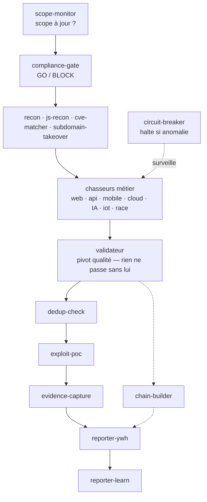
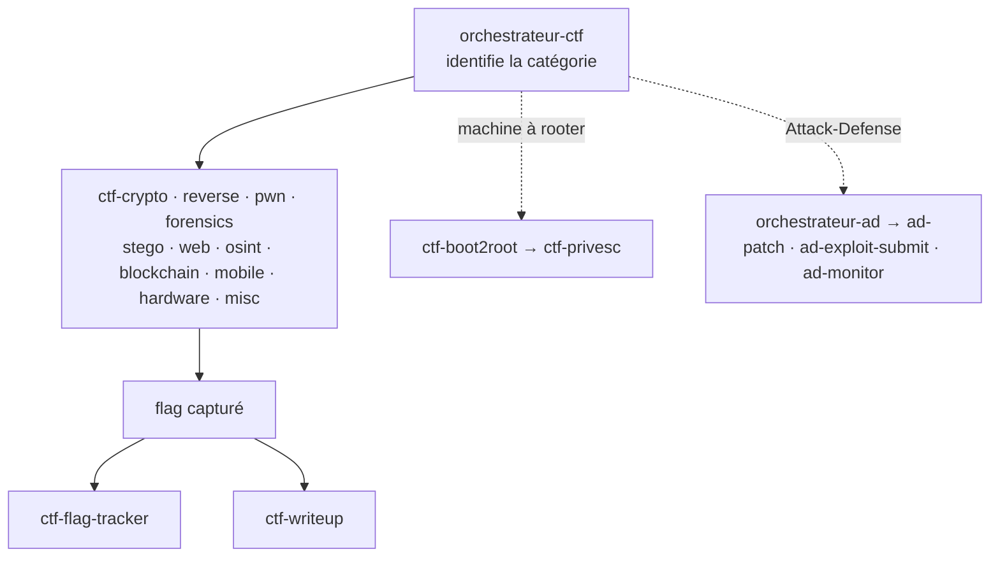

<h1 align="center">Cyber Hunt Toolkit</h1>

  Flotte de <b>56 subagents</b> (Claude Code) pour la chasse de vulnérabilités 
  sur <b>bug bounty autorisés</b> <i>et</i> <b>CTF</b> — scope-gated, preuve minimale non destructive.

  
  
  
  
  
  
  

---

> **Usage autorisé uniquement.** Ce kit s'adresse à des cibles explicitement dans le scope d'un programme bug bounty autorisé (YesWeHack et assimilés), ou à tes propres labs / CTF. Aucun usage sur un système tiers sans autorisation.

Kit **portable** regroupant les **agents** et les **méthodes** — sans aucun compte rendu ni donnée de programme. Il s'installe « à blanc » : tu ajoutes tes propres cibles autorisées.

Deux flottes qui partagent les mêmes garde-fous :

- **Bug bounty (36 agents)** — recon → chasseurs → validation → rapport YesWeHack, preuve minimale non destructive.
- **CTF (20 agents)** — un orchestrateur par format (Jeopardy, Attack-Defense, boot2root), des agents par catégorie, capture de flag + writeup.

## Pipeline bug bounty

## Pipeline CTF

## Les 56 agents

### Bug bounty (36)
| Groupe | Agents |
|---|---|
| Méta / build | `meta-agent` → `cyber-builder` |
| Orchestration + garde-fous | `orchestrateur`, `compliance-gate`, `scope-monitor`, `circuit-breaker`, `dedup-check` |
| Reconnaissance | `recon`, `js-recon`, `cve-matcher`, `scanner`, `subdomain-takeover` |
| Chasseurs web | `web-auth`, `xss-hunter`, `idor-hunter`, `cors-clickjack`, `logic-abuse`, `secret-hunter` |
| Chasseurs API | `api-rest`, `graphql-hunter`, `ssrf-hunter` |
| Chasseurs spécialisés | `payment-logic`, `race-condition`, `mobile-apk`, `llm-prompt-injection`, `cloud-misconfig`, `iot-router` |
| Support auth | `auth-session` |
| Validation / preuve | `validateur`, `exploit-poc`, `evidence-capture`, `chain-builder` |
| Rapports | `reporter-ywh`, `reporter-learn`, `triage-writer`, `vps-manager` |

### CTF (20)
| Format / groupe | Agents |
|---|---|
| Jeopardy — orchestration | `orchestrateur-ctf` |
| Jeopardy — catégories | `ctf-crypto`, `ctf-reverse`, `ctf-pwn`, `ctf-forensics`, `ctf-stego`, `ctf-web`, `ctf-osint`, `ctf-blockchain`, `ctf-mobile`, `ctf-hardware`, `ctf-misc` |
| Jeopardy — support | `ctf-flag-tracker`, `ctf-writeup` |
| Boot2root / pentest | `ctf-boot2root`, `ctf-privesc` |
| Attack-Defense | `orchestrateur-ad`, `ad-patch`, `ad-exploit-submit`, `ad-monitor` |

## Gate de scope (règle centrale)

Avant **tout** test, chaque agent lit le scope de la cible et rend un verdict :

- **IN_SCOPE** — la cible est explicitement listée, le test peut démarrer.
- **OUT_OF_SCOPE** — absente du scope ou exclue, STOP, aucun test.
- **UNCLEAR** — ambiguë, remontée à l'orchestrateur, jamais testée par défaut.

Le gate renvoie toujours : **verdict + ligne de scope citée + raison**. En CTF, le « scope » est l'objet du challenge fourni et autorisé — jamais l'infra de la plateforme ni les autres équipes.

## Contenu

- **`agents/`** — les 56 définitions de subagents. À installer dans `~/.claude/agents/`.
- **`cyber/`** — l'arborescence de travail (à installer dans `~/cyber/`) :
  - `targets/` — gate de scope : `README.md`, `_TEMPLATE-scope.md`, `INDEX.md` (table de lookup).
  - `knowledge/` — mémoire partagée templatée, vidée : `coverage-log.md`, `findings-log.md`, `patterns.md`, `lessons.md`, `playbooks/`, `custom-nuclei/`, `cve/`, `cwe/` (référentiel CWE générique), `_TEMPLATE-metier-agent.md`.
  - `runs/` — un sous-dossier par run (`<cible>-<date>/`).
- **`INSTALL-PROMPT.md`** — prompt à coller dans Claude Code pour installer la flotte.

> **Non inclus (volontairement)** : aucune fiche de programme réel, aucun run, aucune entrée réelle de log. Le kit s'installe à blanc.

## Contrat de chemins

| Usage | Chemin |
|---|---|
| Scope d'une cible | `~/cyber/targets/<cible>.md` (+ lookup `INDEX.md`) |
| Mémoire partagée | `~/cyber/knowledge/coverage-log.md`, `patterns.md`, `findings-log.md` |
| Sorties d'un run | `~/cyber/runs/<cible>-<date>/` |

## Installation

Ouvre une session **Claude Code** à la racine de ce kit et suis [`INSTALL-PROMPT.md`](INSTALL-PROMPT.md) : il copie `agents/*` vers `~/.claude/agents/` et `cyber/*` vers `~/cyber/`, vérifie les agents, et rappelle les règles de conduite.

Ensuite, selon la cible :

| Tu veux… | Crée le scope puis invoque |
|---|---|
| Un programme bug bounty | `~/cyber/targets/<prog>.md` → `orchestrateur` |
| Un CTF Jeopardy | `~/cyber/targets/<ctf>.md` → `orchestrateur-ctf` |
| Une machine à rooter (HTB/THM) | `~/cyber/targets/<box>.md` → `ctf-boot2root` |
| Une compétition Attack-Defense | `~/cyber/targets/<ad>.md` → `orchestrateur-ad` |

## Règles de conduite (non négociables)

- Agir uniquement sur une cible explicitement **autorisée**. Hors scope / ambigu : `OUT_OF_SCOPE` / `UNCLEAR`, STOP.
- Preuve minimale, **non destructive** (bug bounty). En CTF : exploitation complète autorisée **sur l'objet du challenge fourni uniquement**, jamais l'infra de la plateforme ni les autres équipes.
- Aucune donnée personnelle / financière réelle de tiers lue, copiée ou conservée. **Comptes de test uniquement.**
- Pas de DoS, bruteforce massif, exfiltration, persistance, mouvement latéral hors cadre.
- Arrêt immédiat si erreurs en série, ralentissement visible, ou accès à des données tierces (`circuit-breaker`).
- `meta-agent` et `cyber-builder` ne créent **aucun outil offensif** : documentation et configuration seulement.

## Crédits

- **Flotte initiale (bug bounty)** conçue par **Lucas Gemo** ([pepperhot/cyber-hunt-toolkit](https://github.com/pepperhot/cyber-hunt-toolkit)) — l'architecture scope-gated, le pipeline de validation et les premiers chasseurs.
- **Fiabilisation, extension à 56 agents et flottes CTF** (Jeopardy, Attack-Defense, boot2root) par **[Arwy07](https://github.com/Arwy07/cyber-hunt-fleet)** — fork qui reprend le travail de Lucas pour le corriger, le durcir et élargir la couverture.

## Licence

[MIT](LICENSE) — usage strictement sur des programmes et cibles **autorisés**.
